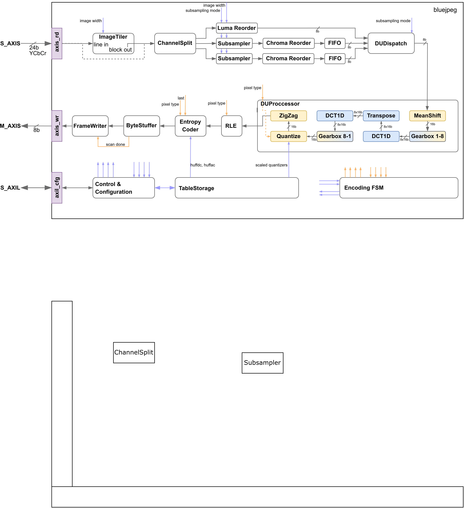

## bluejpeg

A configurable JPEG encoder written in Bluespec SystemVerilog (BSV).
The goal is to provide a parameterizable encoder "generator" that can produce
synthesizable Verilog JPEG encoders tailored to specific hardware-budget and
image-size requirements - change a few compile-time parameters, rebuild, and get
a ready-to-use core.



### Compile-time parameters

| Parameter       | Purpose                                            | Example    |
| --------------- | -------------------------------------------------- | ---------- |
| `max_img_width` | Maximum supported image width; affects BRAM sizing | 1920       |
| `dct_scale`     | Internal DCT fixed-point bit width                 | 12, 14, 16 |
| `quant_scale`   | Quantization arithmetic bit width                  | 12, 14, 16 |

### Runtime configuration (AXI4-Lite)

| Offset | Register | Description                                    |
| ------ | -------- | ---------------------------------------------- |
| 0x00   | CTRL     | `[0]` start, `[1]` done, `[2]` error           |
| 0x04   | STATUS   | `[0]` tables ready, `[1]` codegen busy         |
| 0x08   | IMG_SIZE | `[15:0]` width, `[31:16]` height               |
| 0x0C   | SUBSAMP  | `[1:0]` mode (0 = 4:4:4, 1 = 4:2:2, 2 = 4:2:0) |
| 0x10   | CODEGEN  | `[1:0]` table type, `[31]` trigger             |
| 0x100+ | TABLE WR | Quantization / Huffman table data writes       |

---

### Implementation status

#### Pipeline

- [x] 8×8 block tiling - `mkImageTilingEngine` (BRAM line-buffer, configurable max width)
- [x] Channel splitting - `mkChannelSplitter` (Y / Cb / Cr)
- [x] DU dispatch - `mkDUDispatcher` (interleaves blocks per subsampling mode)
- [x] Y block reorder - `mkYBlockReorder` (MCU pairing for 4:2:0)
- [x] Chroma subsampling - `mkChromaSubsampler`
- [x] Image Tiler optional (can be implemented with 2D DMA engines)

#### DU processing (`mkDUProc`)

- [x] 2D DCT (AAN algorithm) - `mkDCT1D`, `mkDCT2D`, `mkDCT2D_Opt`
  - Separated row/column 1D transforms, 5 multiplications
  - Optimized variant saves ~36 % LUTs / ~65 % registers
- [x] Quantization - `mkQuantize`, `mkQuantize_RT`
  - Compile-time or runtime tables; AAN scaling factors integrated
- [x] Zigzag reorder - `mkZigZag`, `mkZigZag_Opt`
  - Standard + LUTRAM-optimised variant

#### Entropy encoding

- [x] RLE - `mkRLE` (DC differential, ZRL 16×0 tokens, EOB)
- [x] Huffman encoding - `mkHuffEncoder` (dual DC/AC tables, per-component selection, on-chip code generation)
- [x] Bitstream packing - `mkJPEGBitstream` (64-bit accumulator, 0xFF byte-stuffing, final padding)
- [x] JFIF frame assembly - `mkJPEGFramewriter` (SOI, APP0, DQT×2, SOF0, DHT×4, SOS, scan data, EOI)

#### Interfaces & configuration

- [x] AXI4-Stream I/O - 24-bit RGB in, 8-bit JPEG out
- [x] AXI4-Lite config register map - `blue_jpeg_csrs`
- [x] Standard quantization & Huffman tables - `DefaultTables` (ITU-T T.81 Annex K)

#### Utilities

- [x] Transpose buffer - `mkTransposeBuffer`, `mkTransposeBufferOpt` (register or BRAM-based)
- [x] RGB to YCbCr conversion - `mkRGB2YCbCrConv` (standalone, not wired into main pipeline)

#### Not yet completed

- [ ] Improve Image Tiler latency
- [ ] Allow removal of scaled quantization table writes, auto scale quant values upon configuration
- [ ] Working verilog simulation for all testbenches (VPI imports still fail)
- [ ] Hardware verification on FPGA
- [ ] Better configuration mechanism (presets / config package instead of raw `numeric type` parameters)
- [ ] Grayscale-only mode (always 3-component)
- [ ] Parallel MCU encoding (pipeline is serial)
- [ ] Arithmetic coding (Huffman only for now)

---

### Software reference

The `sw/` directory contains a C++23 reference JPEG encoder.  It is also used
during simulation for per-stage verification via Bluespec DPI (BDPI), see
`hdl/encoder/src/BDPI/jpeg_references.cpp`.

**Status:** work-in-progress - the reference is not yet bit-exact with the
hardware pipeline and the code is not well organized.

```sh
cd sw && mkdir build && cd build
cmake .. && make
./encode <input.bmp> <output.jpg>
```

---

### Repository layout

```
hdl/encoder/
  src/          BSV source (pipeline modules, top-level, utilities)
  src/BDPI/     C++ reference functions called via DPI during simulation
  test/         Per-module and full-pipeline testbenches
  Makefile      Build & test targets (Bluesim + Vivado synthesis)
sw/             C++ reference encoder & tests
dep/            Third-party libraries (BlueAXI, BlueLib, CImg, …)
assets/         Diagrams, test images
```

### Building

See the `hdl/encoder/Makefile`.  Key targets:

```sh
make compile          # compile BSV for Bluesim
make sim              # run simulation (default: TestBlueJPEG)
make verilog          # generate Verilog from mkBlueJPEG
```

At the moment, generating the verilog for a specific module works like this:
```sh
make SIM_TYPE=VERILOG MAIN_MODULE=SynthTest TOP_MODULE=mkBlueJPEGTop_2560_12_12 compile_top
```