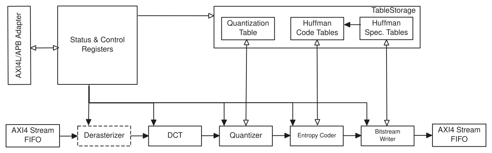

# BlueJPEG

Baseline JPEG encoder in Bluespec SystemVerilog. Compile-time parameters set the maximum image width,
arithmetic precision, colour mode and input buffering. The core takes YCbCr pixels over AXI4-Stream,
is configured over AXI4-Lite and emits a complete JFIF file.

- Baseline sequential DCT with Huffman coding
- YCbCr 4:4:4 or grayscale, 8-bit samples, image size set at runtime up to the configured width
- Quantization and Huffman tables programmable at runtime, Huffman codes generated on chip
- One component sample per cycle, so three cycles per 4:4:4 pixel, 99.7 % of that rate at 1080p
- DCT in its own clock domain
- Output byte-identical to the C++ reference encoder in `sw/` at 12-bit precision
- 1920 × 1080 at 31.9 frames per second on an Artix-7 with the encoder at 200 MHz

## Architecture



The tiler (*Derasterizer* in the figure) buffers eight raster lines in BRAM and reads them out as
8 × 8 blocks. With double buffering the next strip fills while the current one drains. Each block is
split into Y, Cb and Cr data units, which share one processing lane with mean shift, AAN 2D DCT (row
DCT, transpose buffer, column DCT), quantization with the AAN scale factors folded into the tables,
and zigzag reordering. Run-length coding and Huffman coding produce codewords, the bitstream writer packs
them into bytes and stuffs `0x00` after every `0xFF`, and the frame writer prepends the JFIF headers.
All stages are elastic, so output back-pressure propagates to the pixel input.

Block diagram with stage widths in [`assets/system.drawio.png`](assets/system.drawio.png), full
description in [`assets/architecture/bluejpeg-architecture.pdf`](assets/architecture/bluejpeg-architecture.pdf).

## Configuration

Compile-time parameters are the fields and numeric types of `BlueJPEGCfg_t` in
`hdl/src/encoder/BlueJPEG.bsv`.

| Parameter | Effect | Typical values |
| --- | --- | --- |
| `max_img_width` | Maximum image width, sizes the tiler line buffer, which dominates BRAM use | 720, 1920, 2560 |
| `dct_scale` | Fixed-point width inside the DCT | 12, 14, 16 |
| `quant_scale` | Fixed-point width of the quantizer arithmetic and the scaled tables | 12, 14, 16 |
| `pixel_width` | Input sample width | 8 |
| `en_chroma` | Builds the colour path, grayscale-only when disabled | `True`, `False` |
| `en_tiler` | Builds the tiler, without it the input must arrive in 8 × 8 block order | `True`, `False` |
| `double_buffer_tiler` | Doubles the line buffer to accept a strip while the last one drains | `True`, `False` |
| `shallow_dct` | Two register stages per DCT pass instead of seven, for a DCT clock well below the main clock | `True`, `False` |
| `slow_clock`, `slow_reset` | Clock and reset of the DCT, which may be the main clock | |

```bsv
BlueJPEGCfg_t#(1920, 12, 12, 8) cfg = BlueJPEGCfg_t {
    slow_clock:          clk_dct,
    slow_reset:          rst_dct,
    _prx_miw:            ?,
    _prx_dsc:            ?,
    _prx_qsc:            ?,
    _prx_pixw:           ?,
    en_tiler:            True,
    double_buffer_tiler: True,
    en_chroma:           True,
    shallow_dct:         False
};
BlueJPEG_ifc i_enc <- mkBlueJPEG(cfg);
```

Image size and tables are set through the register map. The tables reset to ITU-T T.81 Annex K.
`hdl/src/synth/SynthTest.bsv` has ready-made tops such as `mkBlueJPEGTop_1920_12`,
`mkBlueJPEGTop_1920_12_shallow`, `mkBlueJPEGTop_2560_12_12`, `mkBlueJPEGGrayTop_1920_12_12` and
`mkBlueJPEGGrayTop_720_12_12`.

## Integration

| Port | Direction | Description |
| --- | --- | --- |
| `s_axis` | in | AXI4-Stream with 24-bit pixels `{Y, Cb, Cr}` in raster order |
| `m_axis` | out | AXI4-Stream with 8-bit JPEG bytes, `tlast` marks the final byte of the file |
| `s_axi_cfg_rd`, `s_axi_cfg_wr` | in | AXI4-Lite register map with 32-bit data |
| `irq` | out | High while an enabled interrupt is pending |
| `busy` | out | High while a frame is encoded |

1. Wait for `STS.RDY`, set after reset once the default tables and Huffman codes are loaded
2. Write `IMSZ`, enable interrupts in `IRQE` and set `CTRL.START`
3. Send width × height pixels on `s_axis` and receive the JFIF file on `m_axis`
4. `IRQP.DONE` marks the end of the frame (write 1 to clear). An invalid size raises `IRQP.INV`

Tables can be rewritten between frames. After changing a Huffman table, regenerate its codes through
`CGEN`. `PERF0` to `PERF6` report statistics of the last frame.

## Register map

Byte offsets, one table entry per 32-bit word. Generated from `hdl/src/encoder/BlueJPEGRegs.bsv`.

<!-- regmap:begin -->
```text
Offset         Register   Description                        Field  Bits     Access  Reset  Field description
0x0000         MIV        Module ID & Version Register.      MID    [11:00]  RC      0x1    Unique ID for this module.
                                                             VRS    [18:16]  RC      0x0    Module version.
0x0004         CTRL       Control Register.                  START  [00:00]  RW      0x0    Writing 1 requests processing. Hardware clears the request when it is accepted or rejected.
0x0008         STS        Status Register.                   RDY    [00:00]  RO      0x0    Set once the default tables are loaded and their Huffman codes generated after reset. Low while a codegen runs.
                                                             CGB    [01:01]  RO      0x0    Indicates whether huffman table codegen is running.
                                                             DONE   [04:04]  RO      0x0    Set on frame completion and cleared when a new frame is accepted.
0x000c         IMSZ       Image Size.                        IMW    [15:00]  RW      0x0
                                                             IMH    [31:16]  RW      0x0
0x0014         CGEN       Huffman Codegen Config.            TBL    [01:00]  RW      0x0    Controls which table type to generate. 00=DC LUMA, 01=DC CHROMA, 10=AC LUMA, 11=AC CHROMA.
                                                             TRG    [31:31]  RW      0x0    Writing 1 triggers Huffman code generation from the stored tables. Hardware clears it when the codegen starts.
0x0018         IRQP       Interrupt Pending (W1C).           DONE   [00:00]  W1C     0x0    A frame was encoded completely.
                                                             INV    [01:01]  W1C     0x0    A start request was rejected because of an invalid image size.
0x001c         IRQE       Interrupt Enable.                  DONE   [00:00]  RW      0x0    Enables Frame Done.
                                                             INV    [01:01]  RW      0x0    Enables Invalid Config.
0x0030         PERF0      Performance Counter Cycles.        CYC    [31:00]  RO      0x0    Number of cycles in running state since last processing start.
0x0034         PERF1      Performance Counter Pixels.        PIX    [31:00]  RO      0x0    Number of pixels processed since last processing start.
0x0038         PERF2      Performance Counter Bytes.         BYTEO  [31:00]  RO      0x0    Number of encoded bytes produced since last processing start.
0x003c         PERF3      Performance Counter Idle Cycles.   IDLE   [31:00]  RO      0x0    Cycles in running state in which no input pixel was accepted.
0x0040         PERF4      Performance Counter Flush Cycles.  FLSH   [31:00]  RO      0x0    Cycles from the last data unit entering the pipeline until the frame is done.
0x0044         PERF5      Performance Counter Frame Cycles.  FRAME  [31:00]  RO      0x0    Cycles from the accepted start request until the frame is done, including configuration.
0x0048         PERF6      Performance Counter Boot Cycles.   BOOT   [31:00]  RO      0x0    Cycles from reset until the default tables and Huffman codes were first ready.
0x0100:0x01ff  QLUMAR                                                                       Raw luma quantization table, used for bitstream generation.
0x0200:0x02ff  QCHROMAR                                                                     Raw chroma quantization table, used for bitstream generation.
0x0300:0x03ff  QLUMASC                                                                      Scaled luma quantization table, used during encoding.
0x0400:0x04ff  QCHROMASC                                                                    Scaled chroma quantization table, used during encoding.
0x0500:0x053f  HBITSDCL                                                                     HUFFBITS table for DC luma components.
0x0540:0x057f  HBITSDCC                                                                     HUFFBITS table for DC chroma components.
0x0580:0x05bf  HBITSACL                                                                     HUFFBITS table for AC luma components.
0x05c0:0x05ff  HBITSACC                                                                     HUFFBITS table for AC chroma components.
0x1000:0x13ff  HVALDCL                                                                      HUFFVAL table for DC luma components.
0x1400:0x17ff  HVALDCC                                                                      HUFFVAL table for DC chroma components.
0x1800:0x1bff  HVALACL                                                                      HUFFVAL table for AC luma components.
0x1c00:0x1fff  HVALACC                                                                      HUFFVAL table for AC chroma components.
```
<!-- regmap:end -->

## Resources and performance

Encoder share of the routed DDR3/UDP system on the PA200T (`xc7a200tfbg484-2`, Vivado 2025.2), with
1920 maximum width, 4:4:4, 12-bit precision, double-buffered tiler, register map and tables.

| Resource | Encoder | Share of the device |
| --- | ---: | ---: |
| Slice LUTs | 6,559 | 4.9 % |
| of which LUT as memory | 978 | |
| Flip-flops | 4,313 | 1.6 % |
| BRAM tiles | 25 | 6.8 % |
| DSP48E1 | 11 | 1.5 % |

The tiler line buffer takes 24 BRAM tiles, the tables two RAMB18. The critical path inside the encoder
is the line buffer address logic, see [`docs/udp-encoder-analysis.md`](docs/udp-encoder-analysis.md)
and [`docs/timing-200mhz.md`](docs/timing-200mhz.md).

Out-of-context implementation of a single configuration, main clock 200 MHz and DCT clock 25 MHz.

```sh
make -C hdl bitstream SYNTH=ooc TOP_MODULE=mkBlueJPEGTop_1920_12
```

Throughput in simulation, 1920 × 1080 4:4:4, non-stalling sink, main clock cycles.

| Clocking | Frame cycles (`PERF5`) | Pixels per cycle | Share of the 1/3 limit |
| --- | ---: | ---: | ---: |
| DCT on the main clock | 6,236,632 | 0.33249 | 99.75 % |
| DCT at one eighth of the main clock | 6,236,760 | 0.33248 | 99.74 % |
| Ideal | 6,220,800 | 0.33333 | 100 % |

The gap to the ideal is the first strip fill, single-cycle bubbles between data units and the flush.
Details in [`docs/throughput-cycles.md`](docs/throughput-cycles.md).

## Example system with 1080p30 over UDP


`hdl/src/system_udp` and `hdl/src/fpga/pa200t_udp` build a system for the PA200T board (Artix-7
`xc7a200t`, DDR3, Gigabit Ethernet). The host loads frames into DDR3 over UDP, the system encodes them
and returns the JPEG as UDP datagrams. Registers are reached over JTAG.

| Domain | Frequency | Contents |
| --- | ---: | --- |
| Encoder | 200 MHz | Tiler, JPEG pipeline, encoder registers |
| DCT | 25 MHz | DCT behind gearboxes to the encoder clock |
| System | 125 MHz | UDP and RGMII, frame control, packetizer, DDR requests |
| Memory | 81.25 MHz | DDR3 controller interface |

On the board a 1920 × 1080 frame takes 31.3 ms (31.9 fps), 290,450 bytes in 284 packets, without
encoder output stalls. All captured frames match the C++ reference. Frames are preloaded because raw
1080p30 needs about 1.5 Gb/s.

```sh
make -C hdl sim RUN_TEST=TbJpegUdpDemo UDP_TEST_1080P=1    # split-clock simulation of three frames
make -C hdl bitstream SYSTEM=udp UDP_DEMO_200=1            # board image
```

System and host tools in [`docs/udp-system.md`](docs/udp-system.md), board procedure and measurements
in [`docs/1080p30-demo.md`](docs/1080p30-demo.md).

## Building and testing

Run inside `nix develop ./nix` from the repository root. FPGA flows also need Vivado.

```sh
make -C hdl sim                                    # default test, RUN_TEST selects hdl/test/<name>.bsv
make -C hdl sim RUN_TEST=TestJPEGBitAccuracy       # JPEG bytes compared with the C++ reference
make -C hdl sim RUN_TEST=TbEncoderThroughput UDP_TEST_1080P=1   # 1080p throughput budget and byte check
make -C hdl sim RUN_TEST=TestJpegSystem            # small test system, pattern ROM to encoder to UART
make -C hdl bitstream                              # PA200T design sending a 192 × 192 test image over UART
```

Each test builds in `hdl/build/<RUN_TEST>` and fails when its output contains `ERROR`. Testbenches
compare against the C++ reference through BDPI. The reference also builds standalone.

```sh
cd sw && mkdir build && cd build && cmake .. && make
./encode <input.bmp> <output.jpg>
```

## Repository layout

```text
hdl/src/encoder/     encoder core, mkBlueJPEG and its pipeline stages
hdl/src/synth/       synthesis tops and Vivado scripts for out-of-context runs
hdl/src/system/      UART test system, pattern ROM to encoder to UART
hdl/src/system_udp/  DDR3 and UDP system with loader, frame store, packetizer and clock crossings
hdl/src/fpga/        PA200T board tops for both systems with PLLs, JTAG, pins and constraints
hdl/test/            Bluesim testbenches, hdl/test/bdpi holds the C++ reference models
sw/                  C++ reference encoder
docs/                design notes and measurements
assets/              diagrams and test images
dep/                 submodules such as BSVTools, blueethernet, bluecsr, bluefabric, bluej, blueuart and bluexlnx
```

## Further work

- Chroma subsampling (4:2:2 and 4:2:0) in addition to 4:4:4 and grayscale
- Several data unit lanes in parallel to go beyond one component sample per cycle
- Restart markers, and progressive or arithmetic coding beyond the baseline profile
- Deriving the scaled quantization tables in hardware, so only the raw tables need to be written
- Named configuration presets in place of raw numeric type parameters

## License

MIT, see [`LICENSE`](LICENSE). Submodules under `dep/` carry their own licences.
