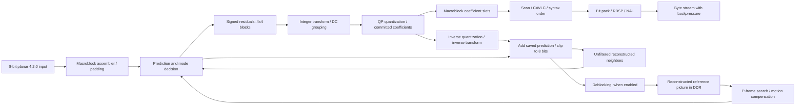

**A Bluespec H.264 encoder composed like BlueJPEG is feasible, but it should be a new codec core sharing BlueJPEG's infrastructure. A restricted intra encoder is a practical first project; an efficient I/P video encoder is a substantially larger undertaking.**

Assessment date: 2026-11-12. This is a source and architecture assessment, not an implementation or an FPGA performance result. Initial assumptions: progressive 8-bit YCbCr 4:2:0, Baseline-compatible syntax, CAVLC, initially fixed QP, and backpressurable input/output. The user subsequently specified 1080p60 or 720p120 and approximately 20-35 Mbps usable RF payload; the comparison and revised implications appear below. Compression quality and acceptable latency remain unspecified. The PA200T and a hypothetical 200 MHz core are used for concrete budgets, not as achieved H.264 operating points.

Sources inspected were BlueJPEG at local HEAD `b2ce4df0056bb4f0bdb9f828371db789cdff9008` with the existing working tree, and shallow public source checkouts:

| Reference | Inspected revision | What it contributes |
| --- | --- | --- |
| [freecores/bluespec-h264](https://github.com/freecores/bluespec-h264) | `830316690d85af50626f844751febd60986e80a7` (2008-07-06) | BSV inverse quantization/transform, prediction/reconstruction, interpolation, deblocking and frame-memory examples |
| [hamza-akhtar-dev/h264encoder](https://github.com/hamza-akhtar-dev/h264encoder) | `b619d1fa4c0d796e720c88ec1644106449a8b9be` (2023-12-10) | Smaller SystemVerilog forward/inverse transform, quantization, intra prediction, CAVLC and byte packing; separate motion-estimation work |
| [openasic-org/xk264](https://github.com/openasic-org/xk264) | `b59222e67fb77917a3afe97941c9a25b2b3a41f9` (2023-03-22) | The broadest encoder architecture: integer/fractional motion estimation, motion compensation, intra prediction, transform/reconstruction, CAVLC and deblocking |

The [H.264 specification](https://www.itu.int/rec/T-REC-H.264) remains the authority for syntax and decoder arithmetic. Encoder search and mode-selection heuristics can be deliberately restricted while producing a compliant stream. Supporting a profile does not require an encoder to emit every coding mode that profile permits.

BlueJPEG already establishes the desired composition in [BlueJPEG.bsv](../hdl/src/encoder/BlueJPEG.bsv) and [DUProc.bsv](../hdl/src/encoder/DUProc.bsv): typed stream interfaces, explicit state owners, small processing modules and a readable top level. The reusable assets are primarily that organization, AXI adapters, BlueCSR, BRAM access patterns, simulation infrastructure, host transport and board integration.

| Existing JPEG element | H.264 applicability |
| --- | --- |
| AXI stream, CSR, counters, interrupts | Reuse the mechanisms; define H.264 frame/NAL/configuration semantics |
| Tiler and banked memory | Reuse implementation patterns and possibly the generic tiler after testing new dimensions; add 16x16 macroblock layout, 4:2:0 planes, padding and codec block order |
| RGB conversion | Optional frontend reuse after checking color matrix, range and chroma sampling; the core currently accepts 4:4:4 samples |
| JPEG DCT | Replace: Baseline uses an integer 4x4 residual transform and separate DC transforms, not the JPEG 8x8 AAN transform |
| JPEG quantizer | Replace with QP-dependent H.264 scaling, rounding and chroma-QP mapping |
| Zigzag/RLE/Huffman | Replace with H.264 scan arrangements and CAVLC, including neighboring-block context |
| JPEG bitstream/framewriter | Reuse packing ideas only; implement Exp-Golomb syntax, SPS/PPS/slice headers, RBSP trailing bits, NAL framing and emulation prevention |
| DDR/UDP system | Reuse board and transport infrastructure; add reconstructed reference surfaces, caching and scheduling for inter coding |

H.264 emulation prevention is different from JPEG's `0xff` stuffing. Likewise, JPEG's 8-bit centered samples must become signed prediction residuals: subtracting two 8-bit samples requires 9 signed bits. Transform intermediates, quantized levels and reconstruction rounding need independently derived bounds.

The decoder is useful because an encoder contains a local reconstruction path. Its [`mkH264`](https://github.com/freecores/bluespec-h264/blob/master/src/mkH264.bsv) already composes inverse transform, prediction, deblocking and buffer control through BSV interfaces. Its `mkInverseTrans` handles regular 4x4 residuals, intra-16x16 DC and chroma DC. Those algorithms are candidates for extraction, not a ready encoder subsystem. The interfaces carry decoder syntax tokens, some coefficient input is in reverse scan order, prediction combines several responsibilities, and `H264Types.bsv` contains global size/reference-count choices. Select one source variant, establish a modern BSC baseline, and wrap or extract individual functions. The CAVLC and Exp-Golomb files decode codes; they do not provide an encoder by reversing stream direction.

The hamza README identifies its encoder as a conversion of hardh264. Source inspection is more informative than the name: `h264topskeleton.sv` and `h264topsim.sv` drive header `SINTRA` and `MINTRA` high and motion-vector inputs to zero. The simulator instantiates a motion estimator, but that does not establish a functioning inter encoding path. The skeleton also declares `CLK`/`CLK2` while connecting several instances to lowercase `clk`/`clk2`, which must be resolved before treating it as a working synthesis top. Use its smaller blocks as references, with independent arithmetic and bitstream tests.

xk264's [README](https://github.com/openasic-org/xk264/blob/main/README.md) advertises 8-bit 4:2:0 Baseline I/P, quarter-pixel interpolation, CAVLC, deblocking and FHD60. Its source contains corresponding subsystems, but that is not an FHD60 result on the PA200T. `top.v` uses wide pixel/memory interfaces and start/done stage control; `top_ctrl.v` schedules overlapping macroblocks. A BSV rewrite still needs an architecture that preserves resource ownership and neighbor dependencies. Its RAM wrappers distinguish behavioral and FPGA implementations; the included software is `f264.exe`, rather than portable reference-model source. The supplied 416x240 testbench expects input/golden files under `tv/`, which are absent from this checkout.

There is also a concrete source-reuse issue: xk264's README offers research/production use, while RTL file headers restrict modification and redistribution without written consent. The hamza checkout has no top-level license file. The inspected MIT decoder files contain MIT license notices. Resolve the encoder projects' permission/provenance before incorporating their implementation into a distributable core; this does not prevent assessing the architecture or independently implementing the standard.

The proposed processing graph preserves BlueJPEG-style module composition while making the feedback explicit:

All stages initially use one core clock; DDR has an explicit request/response boundary and any required CDC. Do not inherit the JPEG slow-DCT clock ratio without a new latency budget: reconstruction latency constrains when dependent prediction can begin. Configuration is separate: latch a frame descriptor at accepted start, distribute the effective QP and slice metadata with work, and apply configuration changes only at declared boundaries. Elaboration chooses implemented modes, lanes, maximum width and memory geometry. Input and output can stall in this initial contract. A live camera later requires a capture buffer and a bounded service/overflow policy.

The important feedback distinction is that spatial intra prediction uses reconstructed neighbors before deblocking, while subsequent pictures use the filtered reference if deblocking is enabled. Original input pixels cannot substitute for reconstructed neighbors. I4x4 also introduces dependencies within a macroblock. Starting with I16x16 DC prediction avoids much of that scheduling difficulty, but still needs the luma DC transform and reconstruction path.

| Stage contract | Proposed token/state and service requirement |
| --- | --- |
| Macroblock assembler | 256 Y + 64 Cb + 64 Cr samples per coded macroblock, with frame/MB coordinates and edge padding; ordered, stallable output |
| Prediction | Prediction samples plus selected mode metadata; wait for required reconstructed neighbors; first version uses I16x16 DC and chroma DC |
| Transform/quantization | Signed 4x4 residuals and QP; special luma/chroma DC grouping; exact output order and arithmetic validated against a software model |
| Committed coefficient fork | Reserve both reconstruction and entropy capacity before accepting work; preserve MB/component/block tags; reconstruction need not wait for bytes to drain |
| Reconstruction | Inverse-scaled residual plus saved prediction, clipped to 8 bits; publish neighbor validity only when the needed samples exist |
| Entropy/syntax | Complete coefficient groups and final macroblock metadata; derive coded block pattern and CAVLC context; emit headers before their residual payload |
| Bitstream | Variable-length syntax tokens into continuous RBSP bytes; signal NAL boundaries and frame completion after final bytes actually leave |

Macroblock storage is needed because headers can depend on coefficients computed later. Do not simply feed coefficients into entropy encoding as soon as quantization produces them. Neighbor mode and nonzero-count context also have ordered update rules. A central macroblock scheduler can own progress and slot allocation while arithmetic remains in separate stream modules.

| Material storage | Initial organization and sizing argument |
| --- | --- |
| Input strips | BRAM-backed 16-line Y plus 8-line Cb/Cr strips; two banks if capture should overlap emission. Capacity derives from maximum width and sampling layout |
| Current/prediction MB | Banked BRAM or small memories; 384 bytes each for raw/predicted samples per resident MB; separate access needs determine banking |
| Coefficient slots | Start with two complete-MB slots; 384 coefficients at a provisional 16 bits each is 768 bytes/slot, plus descriptors. Prove coefficient widths and allocate extra candidate storage if mode search requires it |
| Neighbor state | Line memories for unfiltered reconstructed pixels, modes and CAVLC nonzero counts; width-dependent, with explicit top/left validity |
| Elastic stage boundaries | Shallow guarded queues or skid registers chosen after stage schedules; reserve storage for outstanding RAM responses and avoid a combinational ready cycle through feedback |
| Reference pictures | DDR ping-pong surfaces for one previous reference and current reconstruction, plus an on-chip search-window cache for P frames |

These are capacity proposals, not final FIFO constructors or validated depths. Final queue choice requires measured producer bursts, entropy service and memory latency. Finite queues cannot compensate for sustained undersupply of processing or output bandwidth. Reset clears ownership/validity and outstanding work; stale picture data must never become valid after reset. Frame completion waits for output drain and required reconstruction writes, then reference-surface ownership can change.

A padded 1920x1088 4:2:0 frame occupies 3,133,440 bytes, about 2.99 MiB. Two reconstructed surfaces need about 5.98 MiB before alignment/caches/capture storage. The existing DDR system is a useful starting point, but its input-frame reader is not yet a motion-search/reference-store subsystem. One full-frame reference read plus reconstruction write costs about 188 MB/s at 1080p30 and 376 MB/s at 1080p60; motion search, capture and inefficient bursts add traffic. Cache overlapping search windows instead of re-reading every candidate block from DDR.

| Coded workload | Macroblocks/s | Cycles/MB at an assumed 200 MHz | Component samples/s |
| --- | ---: | ---: | ---: |
| 1280x720 at 30 fps | 108,000 | 1,852 | 41.47 million |
| 1920x1080 at 30 fps, padded to 1088 | 244,800 | 817 | 94.00 million |
| 1920x1080 at 60 fps, padded to 1088 | 489,600 | 408 | 188.01 million |

One scalar 4:2:0 pass consumes 384 component cycles/MB. At 1080p60 that nearly exhausts the 408-cycle budget before control bubbles or candidate searches. Forward and reconstruction passes must overlap on separate resources, and prediction/search may need multiple lanes. Meeting that target is a hardware architecture exercise, not a consequence of translating RTL into BSV. The existing JPEG timing/throughput documents are useful methodological precedents, not measurements for H.264.

For scale, a deliberately naive exhaustive integer search over +/-16 pixels in both dimensions has 1,089 candidates, or 278,784 luma absolute differences per 16x16 macroblock. At 1080p30 this is about 68 billion differences/s. Hierarchical/diamond searches, reused pixels and parallel SAD engines radically change that cost. Restricting search is legal and is the main area/quality tradeoff. Even integer-luma motion vectors can require fractional chroma prediction in 4:2:0, so that first inter increment still needs the correct chroma interpolation.

The recommended development sequence is:

1. Define a small software encoder/model with explicit mode/QP decisions. Establish 4x4 transform, DC grouping, quantization, reconstruction, CAVLC and NAL vectors before building a whole hardware encoder.
2. Build a fixed-QP, all-intra BSV core: I16x16 DC luma, chroma DC, CAVLC, one slice/frame, legal SPS/PPS and IDR pictures. Initially signal deblocking disabled. Use small macroblock-aligned images, then add padding/cropping. This already exercises the full codec path and reconstruction feedback.
3. Make the intra core configurable and robust, then add useful intra modes, I4x4 if wanted, and deblocking. Characterize quality, bits/pixel and throughput on an agreed corpus.
4. Add one reconstructed reference, P16x16 prediction, restricted integer search, motion-vector prediction/differences, chroma interpolation and intra fallback. Add P-skip deliberately with correct inferred-vector semantics.
5. Extend only against a measured need: fractional luma search, smaller partitions, broader search, bitrate control/VBV, more parallelism and higher frame rates.

Do not make CABAC, B pictures, multiple references, interlacing or exhaustive rate-distortion optimization part of the first scope. An all-intra encoder is valid H.264 but offers no temporal compression. Fixed-QP I/P can provide useful video compression; it does not guarantee a target bitrate.

| Scope | Rough cumulative effort for one engineer experienced in BSV and video codecs |
| --- | --- |
| First restricted all-intra stream, simulation milestone | About 1-2 months |
| Maintainable configurable intra core, regression tests and initial FPGA validation | About 2-4 months |
| Useful single-reference I/P core with restricted motion search | About 6-12 months |
| Broader xk264-like feature set with an ambitious verified throughput target | About 9-18+ months |

These are planning judgments, not measured development schedules. Existing trusted models, actual compression targets and an intentionally narrow first configuration can reduce the work. Learning H.264 while implementing it, retargeting memories, timing closure, or requiring broad interoperability increases it. BVI wrappers around existing RTL could accelerate a prototype, but a native, independently composed BSV encoder still requires most codec stages to be implemented or refactored.

Acceptance should combine bit-exact stage checks against the selected software model, decoding output with an independent software decoder, and comparing the hardware's reconstructed references with decoder reconstruction to expose drift. Do not demand byte identity with an unrelated x264 run: valid encoders can make different mode/quantization decisions. Test all legal QPs, DC/chroma cases, picture/slice edges, escape patterns, stalls, reset, consecutive frames and reference switching. For real-time claims measure accepted samples, macroblock initiation intervals, queue occupancy, DDR service and output load; then synthesize and route on the selected device with valid constraints.

No codec behavior, interoperation, resource utilization or H.264 timing has been validated by this assessment. An optional Icarus elaboration probe of xk264 was interrupted without a result; it supplies no build evidence. Numerical budgets above are calculations, not simulation measurements. The source comparison supports starting a separate `BlueH264` core with a restricted intra preset, retaining the JPEG infrastructure and using the decoder's reconstruction algorithms as the first reuse candidates.

**Follow-up: xk265 size and the RF payload requirement.**

The user specified 1080p60 or 720p120, with approximately 20-35 **megabits/s** of usable payload, rather than megabytes/s. This makes bitrate control a requirement of the eventual video core. Fixed-QP intra and restricted inter implementations remain useful development milestones, but are not sufficient evidence that the RF goal is met.

The additional source inspected is [openasic-org/xk265](https://github.com/openasic-org/xk265), revision `832e564a8e59dd90a18fb7ee8e2ed87d96aa03bc` (2023-04-09). Counts below recursively include `.v`, `.sv`, `.vh` and `.svh` files under each repository's `rtl/`. They include RTL memory wrappers and every preprocessor branch, and exclude simulation/testbench directories, external behavioral memory models and software. A lexical comment stripper preserves strings and removes `//` and `/* ... */` comments; a line with remaining non-whitespace is a code line, including declarations, tables and preprocessor directives.

| Metric | xk264 | xk265 | xk265 / xk264 |
| --- | ---: | ---: | ---: |
| RTL files | 127 | 218 | 1.72x |
| Physical lines, including comments/blanks | 39,500 | 141,799 | 3.59x |
| Nonblank, noncomment code lines | 29,592 | 122,359 | 4.13x |
| Entropy subsystem code lines | 4,644 (CAVLC) | 20,942 (CABAC) | 4.51x |

The size increase is not solely codec complexity. For example, xk265's `ime_sad_array.v` occupies 14,852 physical lines and contains extensive explicit replication. BSV vectors/elaboration can express such structures more compactly, but that does not remove their arithmetic units, muxes, routing or bandwidth. LOC is neither a synthesis-area result nor a proportional engineering-effort estimate. No xk265 build or throughput test was performed.

xk265's [feature list](https://github.com/openasic-org/xk265/blob/master/README.md) still specifies **I/P**, not B frames. It adds HEVC's larger/hierarchical coding structure, transform sizes up to 32x32, 35 intra modes, CABAC, skip/merge and SAO. It advertises software CBR/VBR and hardware CTU-level rate control, and `rtl/top/enc_core.v` exposes associated QP/bit-budget interfaces. These features make it a useful compression-oriented reference, but the advertised 4K30 at 400 MHz is not a result on the PA200T. File-header modification/redistribution restrictions analogous to xk264's are also present.

The RF budget gives the following averages, calculated from visible pixels and excluding no further link overhead because the user already described usable payload:

| Mode | Visible pixels/s | Compressed bits/pixel at 20-35 Mbps | Average coded bytes/frame at 20-35 Mbps |
| --- | ---: | ---: | ---: |
| 1920x1080 at 60 fps | 124.416 million | 0.161-0.281 | 41.7-72.9 kB |
| 1280x720 at 120 fps | 110.592 million | 0.181-0.316 | 20.8-36.5 kB |

The processing rates are similar; 720p120 is not half the sustained pixel workload of 1080p60. The latter usually offers more time per frame, whereas the former has only an 8.33 ms frame interval. These bit budgets do not establish an acceptable quality level. Source motion, texture, noise, quantization, prediction search and refresh policy determine that.

I/P-only is not inherently incompatible with this bitrate. The restricted integer-search/P16x16 architecture proposed as an incremental milestone may be too inefficient for the required quality. A stronger H.264 encoder can add fractional motion estimation, smaller partitions, rate-distortion-aware mode decisions, CABAC and rate control while retaining an I/P GOP. HEVC can also retain I/P while changing the coding tools. B pictures are a separate tradeoff that can introduce reordering delay when future references are used; the x265 [documentation](https://x265.readthedocs.io/en/stable/cli.html) explicitly supports I/P operation with `bframes=0`.

The next architecture decision should therefore follow a software quality/rate experiment on representative footage, not LOC alone. Compare H.264 I/P with suitable Main/High-profile tools against HEVC I/P at 20, 27.5 and 35 Mbps, under the same latency/buffer and refresh constraints. Then optionally test B pictures if latency allows them. Software results establish a target for compression tools, not a promise that a simplified hardware encoder matches them. Compare decoded quality, frame-size bursts and link-queue delay as well as average bitrate.

For a constant payload drain rate R, the transmit-queue model is `Q_next = max(0, Q + coded_bits - R * elapsed_time)` with a defined overflow and recovery policy. A 100 kB backlog alone adds 40 ms at 20 Mbps, regardless of codec. Plan a controller that adjusts QP from actual coded bits, frame/block complexity and queue fullness; explicitly constrain refresh/IDR bursts and react if the RF payload capacity varies. Extra FIFO capacity cannot fix an encoder whose sustained output exceeds the current link rate.
