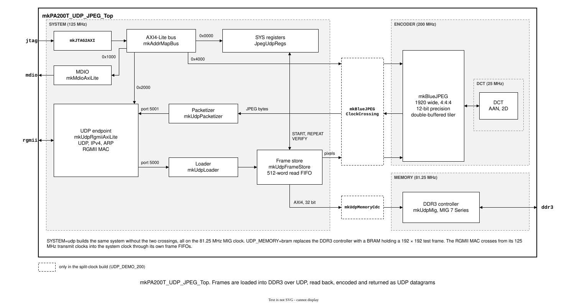

# DDR3/UDP system

Encoder on the PA200T board (Artix-7 `xc7a200tfbg484-2`) with a DDR3 frame store and Gigabit
Ethernet. The host loads YCbCr frames over UDP, the system encodes a stored frame once or repeatedly
and returns the JPEG as numbered UDP datagrams. Board-independent logic is in `hdl/src/system_udp`,
the board top with clocks, pins and constraints in `hdl/src/fpga/pa200t_udp`. The UDP endpoint and
MDIO controller come from [blueethernet](https://github.com/timksf/blueethernet) in `dep/blueethernet`.



## Build variants

| Variant | Make options | Frame store | Clocking |
| --- | --- | --- | --- |
| DDR3 | `SYSTEM=udp` | DDR3 through MIG | Everything on the MIG user clock, 81.25 MHz |
| BRAM | `SYSTEM=udp UDP_MEMORY=bram` | BRAM holding the 192 × 192 test pattern | Everything on 83.333 MHz |
| Split clocks | `SYSTEM=udp UDP_DEMO_200=1` | DDR3 behind a clock crossing | Encoder 200 MHz, DCT 25 MHz, system 125 MHz, memory 81.25 MHz |

The split-clock variant is described in [1080p30-demo.md](1080p30-demo.md). In all variants the
RGMII MAC runs on 125 MHz transmit clocks (plus a 90° copy) and crosses into the application clock
through its frame FIFOs. The RGMII input delays use their own `IODELAY_GROUP` beside the MIG's.

The MIG project in `hdl/src/fpga/pa200t_udp/ip` uses the 325 MHz DDR setting with a 5000 ps input
period, PLL multiplier 13 and divider 2, so it runs from the 200 MHz board clock directly. The build
checks this parameter. The MIG supplies all DDR pin constraints.

## Data path

The frame store serves one client at a time (loader, reader, verify or peek and poke).

- Reader fetches INCR bursts of up to 256 words, never across a 4 KiB boundary, with two bursts in
  flight into a 512-entry BRAM FIFO
- Verify reads a frame and computes two wrapping 32-bit sums, of all words and of the running sums
- Loader writes and peek and poke complete after the AXI write response
- A frame word is `{8'h00, Y, Cb, Cr}` at word address `BASE` plus the raster pixel index

The loader checks length, side-band and pixel range of a whole datagram before writing. Rejected
datagrams are drained, so duplicates are harmless and malformed ones have no effect. The packetizer
stores up to 1024 JPEG bytes per datagram in a 2048-byte BRAM FIFO and fills the next packet while
the previous one is sent.

## Wire formats

Loader datagrams go to UDP port 5000. The payload is the first pixel index (32-bit big-endian)
followed by 1 to 480 pixels of `Y`, `Cb`, `Cr` bytes. They are accepted only while `CTRL.LOADEN` is set
and the system is idle.

JPEG datagrams go to UDP port 5001, an eight-byte header followed by 1 to 1024 JPEG bytes.

| Byte | Field |
| --- | --- |
| 0 | Magic `0x4A` |
| 1 | Flags, bit 0 marks the last packet of a frame |
| 2 and 3 | Frame number, big-endian, wraps |
| 4 and 5 | Sequence number within the frame, big-endian, starting at 0 |
| 6 and 7 | JPEG payload length, big-endian |

## Bus map and registers

| Base | Size | Target |
| --- | --- | --- |
| `0x0000` | `0x1000` | SYS, the system registers in `JpegUdpRegs.bsv` (module ID 3) |
| `0x1000` | `0x1000` | MDIO controller |
| `0x2000` | `0x1000` | ETH, the UDP/IP endpoint registers |
| `0x4000` | `0x2000` | JPEG, the encoder registers listed in the top-level README (module ID 1) |

| Offset | Register | Contents |
| --- | --- | --- |
| `0x00` | MIV | Module ID and version |
| `0x04` | CTRL | Bit 0 START requests one frame and clears itself, bit 1 REPEAT encodes frame after frame while set, bit 2 LOADEN accepts loader datagrams, bit 3 VERIFY computes the checksums and clears itself |
| `0x08` | STS | Bit 0 frame running, bit 1 DDR3 calibrated, bit 2 verify done, bit 3 reader active, bit 4 loader active, bit 5 sticky AXI memory error |
| `0x0c` | NPIX | Pixels per frame, 2,073,600 after reset |
| `0x10` | BASE | Word address of the frame |
| `0x14` | MEMADDR | Word address for MEMDATA |
| `0x18` | MEMDATA | Reads and writes the word at MEMADDR, with byte strobes, and returns SLVERR while busy or out of range |
| `0x20`, `0x24` | CHK1, CHK2 | Verification sums |
| `0x28`, `0x2c`, `0x30` | LDPKT, LDPIX, LDDROP | Accepted loader datagrams, written pixels and dropped datagrams |
| `0x40` | FRAMES | Frames completed since reset, counted when the last packet crosses the UDP interface |
| `0x44`, `0x48` | INCYC, INSTL | Input window from the first to the last accepted pixel, and its cycles with a pixel offered but not accepted |
| `0x4c` | OUTB | JPEG bytes of the frame |
| `0x50`, `0x54` | OUTCYC, OUTSTL | Output window from the first to the last JPEG byte, and its cycles with a byte offered but not accepted |
| `0x58` | TOTAL | Frame start to the last JPEG byte |
| `0x5c` | PKTS | UDP packets of the frame |
| `0x60` | PERIOD | Cycles between the last two frame starts |

The host writes the encoder's `IMSZ` and `IRQE` once. The system then starts frames through
`start_frame`. LED0 shows the encoder interrupt, LED1 DDR3 calibration.

## Building and simulating

Run from the repository root inside `nix develop ./nix`. Bitstreams also need Vivado. The pinned
BSVTools needs `hdl/patches/bsvtools-vivado-exit.patch` so Vivado failures stop the build.

```sh
git -C dep/BSVTools apply ../../hdl/patches/bsvtools-vivado-exit.patch
make -C hdl sim RUN_TEST=TestJpegUdpSystem                     # 192 × 192 end-to-end test
make -C hdl sim RUN_TEST=TestJpegUdpSystem UDP_TEST_1080P=1 BUILDDIR=build/TestJpegUdpSystem1080   # 1920 × 1080
make -C hdl sim RUN_TEST=TbUdpPacketizer                       # packet lengths, stalls, overlap
python3 -m unittest discover -s hdl/test/host/udp -p 'test_*.py' -v
make -C hdl bitstream SYSTEM=udp                               # DDR3 variant
make -C hdl bitstream SYSTEM=udp UDP_MEMORY=bram               # BRAM variant
```

`TestJpegUdpSystem` loads a frame over modelled UDP (including a duplicate and a malformed datagram),
checks peek, poke and checksums, encodes one single and two repeated frames and compares every byte
with the C++ reference. The 1080p fixture is a crop of `assets/sample_1920x1280.bmp`.

## Running on the board

The FPGA is configured over the board's FT232H (SRAM only). Registers are accessed through a J-Link on
the JTAG header. The session script initializes the PHY, UDP endpoint and encoder and keeps OpenOCD
running with Tcl RPC on port 6666. Network addresses default to those in `bluejpeg_udp_jlink.tcl`
and are overridden through the `udp_*` variables.

```sh
openocd -f hdl/test/host/udp/pa200t_load.tcl -c 'pld load 0 /path/to/image.bit' -c shutdown
openocd -f hdl/test/host/udp/bluejpeg_udp_jlink.tcl
```

The BRAM variant overrides frame size and counter clock.

```sh
openocd -c 'set udp_width 192' -c 'set udp_height 192' -c 'set bluejpeg_udp_hz 83333333.333333' -f hdl/test/host/udp/bluejpeg_udp_jlink.tcl
```

- `load_frame.py` crops a BMP to 1920 × 1080, converts it to YCbCr like the C++ reference, sends it,
  runs VERIFY and resends on a checksum mismatch. `--prepare-only` skips network and JTAG
- `recv_jpeg.py` reassembles datagrams, reports gaps, writes `frame_<number>.jpg` and with `--expect`
  requires a byte match against the 1080p simulation output

Start the receiver before requesting frames.

```sh
python3 hdl/test/host/udp/recv_jpeg.py --output udp-rx --expect hdl/build/TestJpegUdpSystem1080/udp_capture.jpg --count 100
python3 hdl/test/host/udp/load_frame.py assets/sample_1920x1280.bmp
```

From the OpenOCD console, start a frame, toggle repeat (the current frame finishes) and print the
counters.

```tcl
bluejpeg_udp_start pa200t.tap
bluejpeg_udp_repeat pa200t.tap 1
bluejpeg_udp_repeat pa200t.tap 0
bluejpeg_udp_report pa200t.tap
```

## Results

| Variant | Clock | Setup slack | Hold slack |
| --- | ---: | ---: | ---: |
| DDR3 | 81.25 MHz | +0.343 ns | +0.008 ns |
| BRAM | 83.333 MHz | +0.306 ns | |

The DDR3 design uses 19,917 LUTs, 18,759 registers, 33 BRAM tiles and 11 DSPs, the encoder share is in
[udp-encoder-analysis.md](udp-encoder-analysis.md). On the board, single frames and runs of 100
repeated frames match the C++ reference for both the 192 × 192 pattern and the 1920 × 1080 frame
(290,450 bytes in 284 packets), without lost packets.
